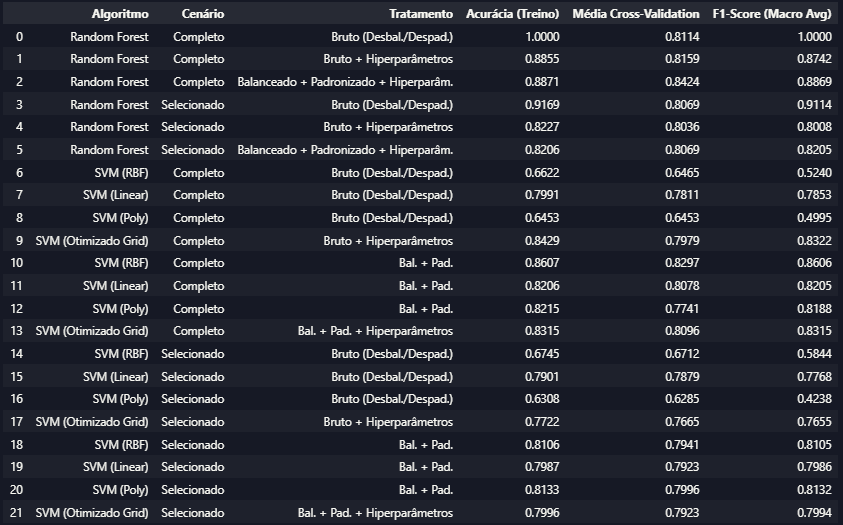
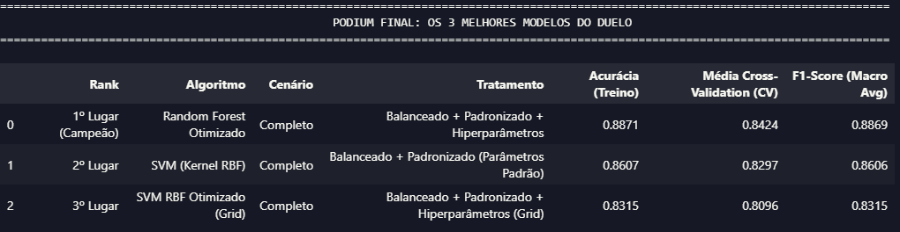
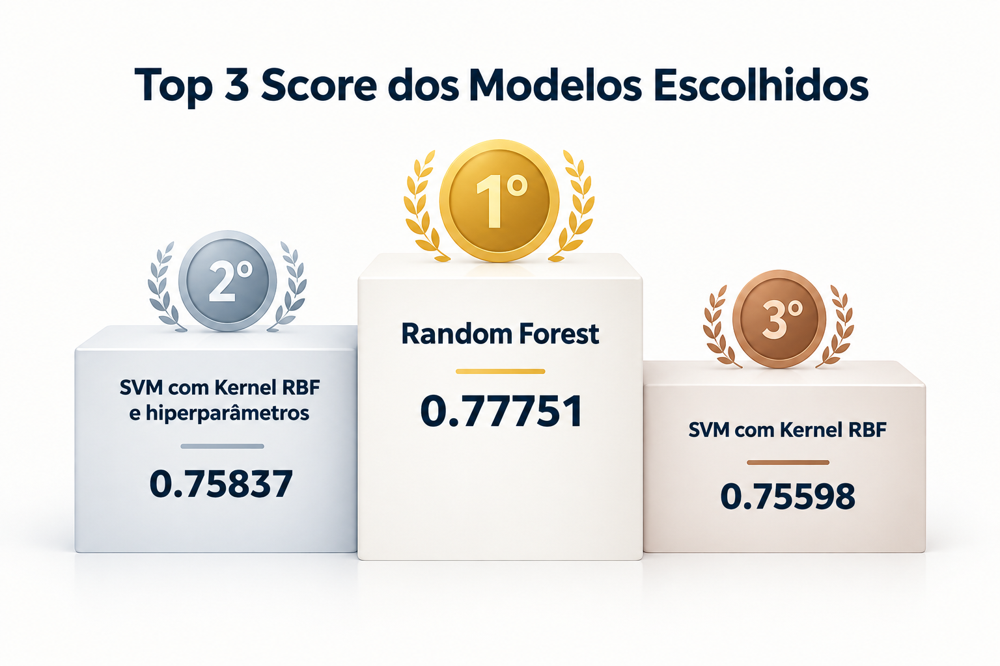

# Duelo de Modelos de Machine Learning — Titanic

## 📌 Sobre o Projeto

Projeto desenvolvido no Módulo Duelo entre modelos 4 da formação em Ciência de Dados da EBAC, com o objetivo de comparar diferentes configurações de modelos de Machine Learning para prever a sobrevivência dos passageiros do Titanic.

A atividade consiste em realizar um duelo entre algoritmos, explorando técnicas de preparação de dados, engenharia de atributos, balanceamento de classes, padronização, otimização de hiperparâmetros e validação cruzada. Ao final, os modelos com melhor desempenho são selecionados para gerar previsões e participar da competição do Titanic na plataforma Kaggle.

O projeto compara duas abordagens de classificação supervisionada: Random Forest, baseado em conjuntos de árvores de decisão, e Support Vector Machine (SVM), que busca encontrar fronteiras de separação entre as classes.

## 🎯 Objetivos

- Desenvolver modelos de classificação binária para prever a variável Survived.
- Realizar análise exploratória e tratamento dos dados.
- Comparar cenários com todas as variáveis disponíveis e com um conjunto reduzido de atributos.
- Avaliar o impacto do balanceamento amostral e da padronização.
- Testar diferentes kernels e configurações de hiperparâmetros do SVM.
- Aplicar GridSearchCV e validação cruzada para avaliar e otimizar os modelos.
- Comparar o desempenho dos modelos por meio de métricas de classificação.
- Selecionar os três melhores modelos e gerar submissões para o Kaggle.

## 🗂️ Base de Dados

O projeto utiliza as bases `train.csv` e `test.csv`, disponibilizadas para a competição do Titanic no Kaggle.

A base de treinamento contém a variável-alvo `Survived`, enquanto a base de teste é utilizada para gerar previsões destinadas à submissão na plataforma.

Entre as principais variáveis analisadas estão:

- **Survived:** sobrevivência do passageiro — variável-alvo.
- **Pclass:** classe socioeconômica da passagem.
- **Sex:** gênero.
- **Age:** idade.
- **SibSp:** número de irmãos/cônjuges a bordo.
- **Parch:** número de pais/filhos a bordo.
- **Fare:** tarifa da passagem.
- **Cabin:** informação sobre a cabine.
- **Embarked:** porto de embarque.

## ⚙️ Etapas do Projeto

### 1. Importação das bibliotecas e carregamento dos dados

Carregamento das bases de treino e teste e utilização das principais bibliotecas para análise, preparação dos dados, treinamento dos modelos e avaliação de desempenho.

### 2. Análise e tratamento dos dados

- Inspeção dos tipos de dados e da estrutura das bases.
- Exclusão das variáveis `Name` e `Ticket` na etapa inicial de modelagem.
- Codificação da variável `Sex` com Label Encoding.
- Aplicação de One-Hot Encoding nas variáveis `Embarked` e `Cabin`.
- Extração da letra inicial de `Cabin` para representar o convés, substituindo valores ausentes por U.
- Tratamento de valores nulos em `Age` e `Fare` por imputação da média.
- Verificação de possíveis outliers, preservando valores considerados plausíveis no contexto dos passageiros.

### 3. Análise de correlação e definição dos cenários

A matriz de correlação foi utilizada para explorar as relações lineares entre as variáveis e a sobrevivência.

Entre os principais resultados observados:

- **Sex:** correlação de aproximadamente -0,54 com a variável-alvo, considerando a codificação aplicada.
- **Pclass:** correlação de aproximadamente -0,34.
- **Cabin_U:** correlação de aproximadamente -0,32.
- **Fare:** correlação positiva de aproximadamente 0,26.

Com base na análise, foram estruturados dois cenários:

- **Cenário completo:** utilização do conjunto de variáveis preparado para a modelagem.
- **Cenário selecionado:** utilização de um subconjunto de atributos escolhido com base na análise de correlação.

A seleção permite comparar o desempenho dos modelos com diferentes conjuntos de atributos.

### 4. Balanceamento e padronização

Foi aplicado SMOTE (Synthetic Minority Over-sampling Technique) nos dados de treinamento para equilibrar a distribuição das classes.

Também foi utilizado StandardScaler para padronizar as variáveis, especialmente relevante para o SVM, cujo desempenho pode ser sensível às diferenças de escala.

Essas técnicas foram incorporadas aos experimentos para avaliar seus efeitos no comportamento dos modelos.

### 5. Duelo de modelos

Foram desenvolvidas 21 configurações de modelos, combinando algoritmos, cenários de variáveis e estratégias de preparação dos dados.

**Random Forest**

- Treinamento com o cenário completo e o selecionado.
- Comparação entre dados desbalanceados e não padronizados e dados submetidos às técnicas de preparação.
- Testes com hiperparâmetros para controlar a complexidade do modelo e buscar melhores resultados.

**Support Vector Machine (SVM)**

- Avaliação dos kernels rbf, linear e poly.
- Comparação entre cenário completo e cenário selecionado.
- Testes com e sem balanceamento e padronização.
- Aplicação de GridSearchCV para buscar combinações de hiperparâmetros.
- Avaliação da estabilidade por validação cruzada.

### 6. Avaliação e comparação dos modelos

Os experimentos foram avaliados por diferentes métricas, com destaque para:

- **Acurácia (Accuracy):** proporção total de previsões corretas.
- **Validação cruzada (Cross-Validation):** avaliação do desempenho em diferentes partições dos dados de treinamento.
- **F1-Score Macro:** média do F1-Score entre as classes, atribuindo o mesmo peso a cada uma delas.
- **Matriz de confusão:** análise dos acertos e erros de classificação.
- **AUC-ROC:** avaliação da capacidade de discriminação entre as classes nos experimentos em que foi calculada.

A comparação final prioriza a estabilidade e o equilíbrio entre as classes, evitando selecionar um modelo apenas pela acurácia obtida no treinamento.

#### 📊 Tabela 1 — Métricas dos 22 modelos treinados

### 7. Seleção dos três melhores modelos

Após a comparação, foram selecionadas as três configurações com melhor desempenho no duelo:

1. **Random Forest Otimizado —** cenário completo, com balanceamento, padronização e hiperparâmetros.
2. **SVM com kernel RBF —** cenário completo, com balanceamento e padronização.
3. **SVM RBF Otimizado —** cenário completo, com balanceamento, padronização e hiperparâmetros.

A seleção considerou a combinação das métricas de treinamento, validação cruzada e F1-Score Macro.

#### 🏆 Tabela 2 — Comparação dos três melhores modelos

### 8. Submissão dos modelos no Kaggle

Os três modelos selecionados foram treinados para gerar previsões sobre a base de teste da competição. As previsões foram organizadas utilizando o identificador PassengerId e exportadas em arquivos CSV para submissão.

Arquivos de previsão gerados:

- submission_rf_complet_best_pred.csv
- submission_svm_rbf_complet_pred.csv
- submission_svm_rbf_complet_best_pred.csv

A pontuação obtida no Kaggle representa uma avaliação adicional do desempenho dos modelos em dados cujos rótulos não estão disponíveis durante o treinamento.

#### 🥇 Tabela 3 — Resultado final do Top 3 no Kaggle

Posição | Modelo | Score Kaggle
---      | --- | ---    
🥇 1º lugar  | Random Forest Otimizado | 0.77751  
🥈 2º lugar | SVM com kernel RBF Otimizado | 0.75837
🥉 3º lugar | SVM com kernel RBF padrão | 0.75598

#### 🏆 Pódio dos modelos

## 🔎 Principais Insights

- **Random Forest Otimizado liderou a competição:** obteve o maior score entre os três modelos selecionados, com 0.77751.
- **SVM com kernel RBF apresentou resultados competitivos:** as versões padrão e otimizada ocuparam o segundo e o terceiro lugares, respectivamente.
- **A preparação dos dados foi importante para a comparação:** balanceamento e padronização foram avaliados como parte das estratégias de modelagem, especialmente para o SVM.
- **A seleção de variáveis alterou o desempenho:** comparar os cenários completo e selecionado permitiu observar como a redução de atributos influencia a capacidade preditiva.
- **A validação cruzada complementou a avaliação:** ajudou a comparar o comportamento dos modelos em diferentes partições dos dados de treinamento.
- **O score do Kaggle ampliou a avaliação:** a submissão possibilitou verificar o desempenho dos modelos em dados separados daqueles utilizados para ajustar os classificadores.

## 🛠️ Tecnologias e Bibliotecas

- Python
- Pandas
- NumPy
- Matplotlib
- Seaborn
- Scikit-learn
- Imbalanced-learn
- Random Forest
- Support Vector Machine (SVM)
- SMOTE
- StandardScaler
- GridSearchCV
- Cross-Validation
- Jupyter Notebook
- Kaggle
- Git e GitHub

## 🧠 Competências Desenvolvidas

- Análise exploratória de dados (EDA)
- Limpeza e tratamento de dados
- Tratamento de valores ausentes
- Engenharia e seleção de atributos
- Análise de correlação
- Balanceamento de classes
- Padronização de variáveis
- Machine Learning supervisionado
- Classificação binária
- Random Forest e SVM
- Otimização de hiperparâmetros
- Validação cruzada
- Avaliação de modelos e análise de métricas
- Comparação de algoritmos
- Geração de previsões e submissão ao Kaggle

## ✅ Conclusão

O projeto permitiu desenvolver um fluxo de trabalho de Machine Learning aplicado a um problema de classificação binária, desde o tratamento dos dados até a avaliação e submissão de previsões em uma competição pública.

A comparação de 22 configurações de modelos possibilitou analisar diferentes estratégias de preparação dos dados, seleção de variáveis, balanceamento, padronização e otimização de hiperparâmetros. O pódio final foi liderado pelo Random Forest Otimizado, seguido por duas configurações de SVM com kernel RBF.

Além do resultado obtido no Kaggle, o projeto reforçou a importância de avaliar modelos por múltiplas métricas, analisar sua estabilidade e testar diferentes configurações antes de escolher uma solução final.